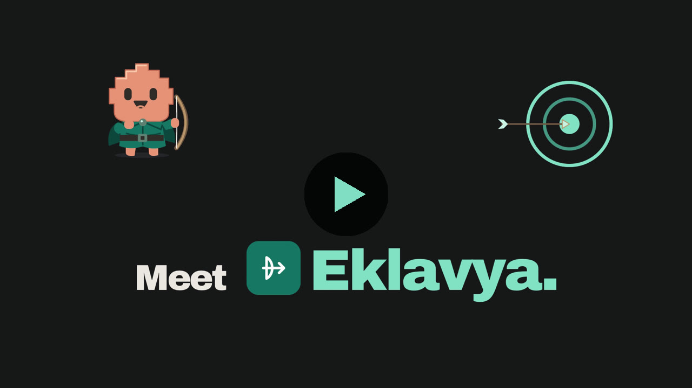
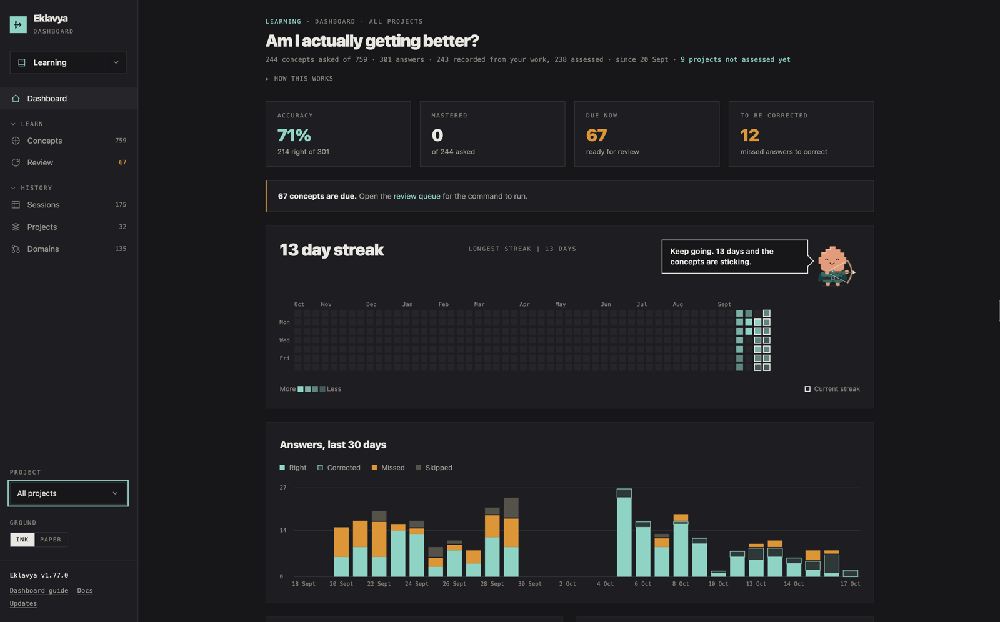
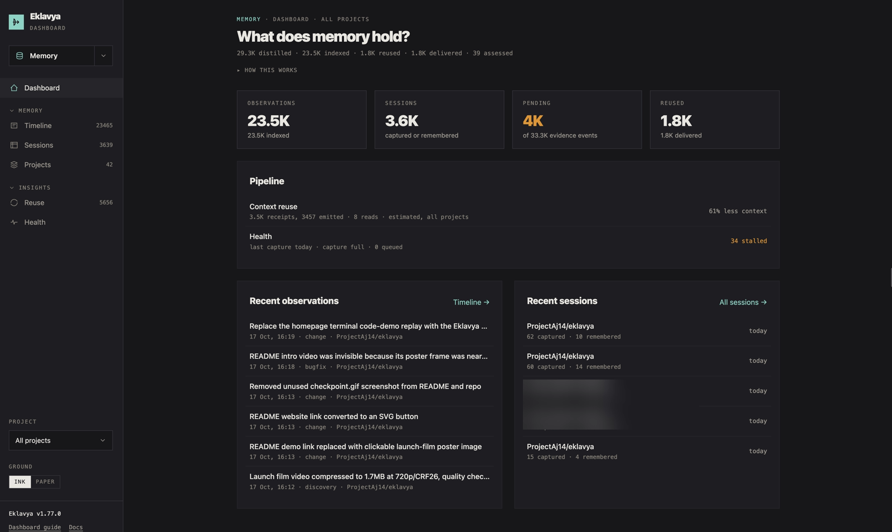
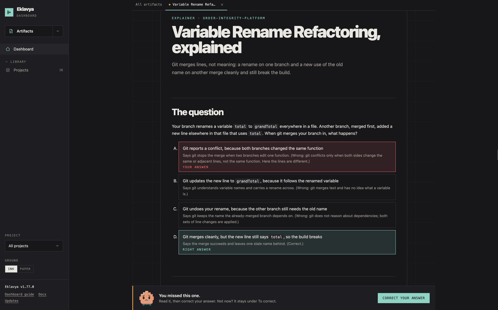
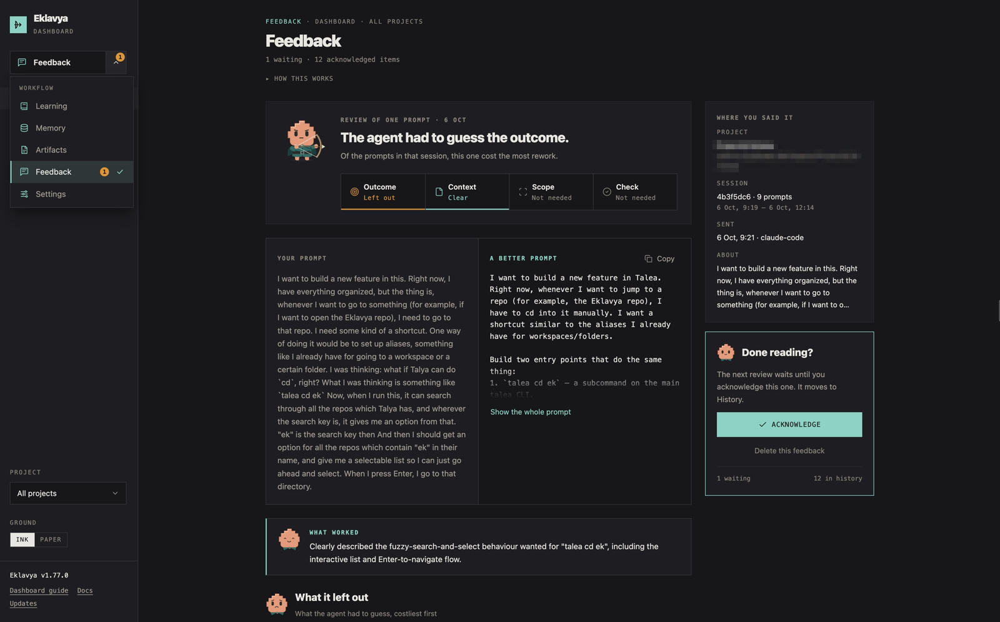
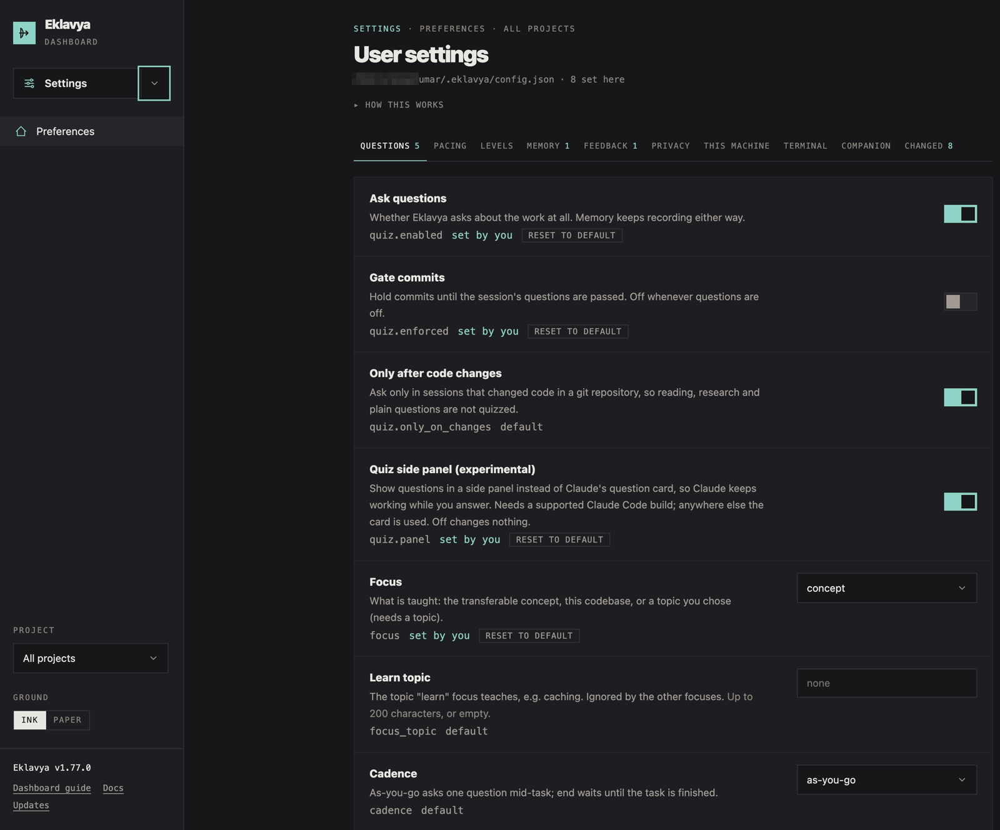
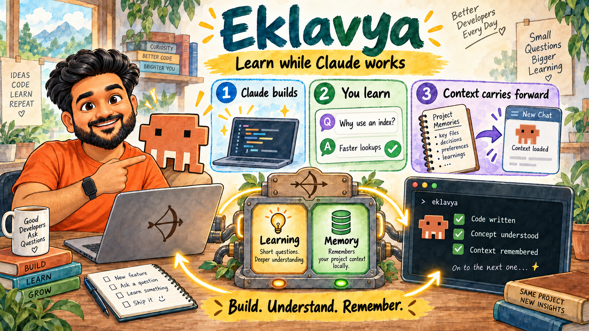

<div align="center">


# Eklavya

**Learn while your agent works — and carry project context forward.**

[](https://eklavya-run.web.app/)

[](https://eklavya-run.web.app/#demo)

*Named for Ekalavya, who mastered archery practicing before a silent statue of his guru. Here, the statue talks back.*

[](https://www.npmjs.com/package/eklavya)
[](LICENSE)
[](https://nodejs.org)

</div>

Eklavya is a plugin for Claude Code. It does two jobs:

1. **It helps you understand the code Claude writes.** It asks you short
   questions about the work, while the work happens.
2. **It remembers what happened in your project.** The next time you open
   Claude, it can recall what you did last time.

Your learning history and memory are stored on your computer. There is no
Eklavya account. Eklavya sends anonymous daily usage counts (including which dashboard
sections and explainers are used), never code, paths, names or text. [Every field is listed](https://eklavya-run.web.app/docs/usage-analytics/),
and `eklavya telemetry off` stops them. New installs use `claude-sonnet-5`
through your Claude Code login for memory summaries and prompt feedback, so
captured session evidence goes to that model. [Memory and data](https://eklavya-run.web.app/docs/memory/)
explains the controls.

<table>
<tr><td colspan="2" align="center"><br><sub><b>Learning</b> — accuracy, streak and reviews that are due</sub></td></tr>
<tr>
<td align="center"><br><sub><b>Memory</b> — what Eklavya remembers about your projects</sub></td>
<td align="center"><br><sub><b>Artifacts</b> — an explainer page for a question you missed</sub></td>
</tr>
<tr>
<td align="center"><br><sub><b>Feedback</b> — a review of one prompt, with a better version</sub></td>
<td align="center"><br><sub><b>Settings</b> — every dial, per user or per project</sub></td>
</tr>
</table>

## What you get

| Feature | In one line | Read more |
|---|---|---|
| Learning | Short questions about the code Claude just wrote. | [First session](https://eklavya-run.web.app/docs/first-session/) |
| Memory | Claude remembers your past work in this project. | [Memory](https://eklavya-run.web.app/docs/memory/) |
| Artifacts | Turn any explanation or incident write-up into a page with diagrams, timelines and a status table. | [Artifacts](https://eklavya-run.web.app/docs/commands/#the-artifacts-skill) |
| Dashboard | See your progress, streak, memory and pages in the browser, and copy a ready-to-run command for your due reviews. | [Dashboard](https://eklavya-run.web.app/docs/dashboard/) |
| Report a problem | Tell Claude a question or grade was wrong: it drafts a GitHub issue with paths and code removed, and files it only after you say yes. | [How to report one](https://eklavya-run.web.app/docs/faq/#how-do-i-report-a-problem-with-eklavya) |
| Dials | Choose what it teaches, when it asks and how hard. | [The dials](https://eklavya-run.web.app/docs/dials/) |
| Commit gate | Optional: pass a quiz before you can commit. The terminal hook also holds commits in linked worktrees. | [Commit gate](https://eklavya-run.web.app/docs/commit-gate/) |

<div align="center">



</div>

## Learning

Eklavya notices the ideas behind Claude's work, like "database index" or
"refresh token". Then it asks you about them.

| What it does | How it works | Read more |
|---|---|---|
| Asks while you work | One question at a time, in the middle of the task, written so you can answer without having read the code, and so the right option is not the longest, the most detailed or explained in advance, and does not always come first. Answer, say you don't know and get the explanation, or skip and move on; a question that was itself at fault never counts against you, and an automatic question is meant to stay one question. | [First session](https://eklavya-run.web.app/docs/first-session/) |
| Asks while agents build | For a larger change, Eklavya asks Claude to hand the building to a background agent (in your task's worktree, one stage at a time for a staged plan) and ask you questions while it works. If Claude starts changing a second file itself, Eklavya reminds it once. | [The dials](https://eklavya-run.web.app/docs/dials/#cadence--when-it-asks) |
| Grades your answer | Each answer gets a grade and a short explanation. | [Grading](https://eklavya-run.web.app/docs/grading-engine/) |
| Brings topics back | Spaced reviews bring an idea back before you forget it. | [Grading](https://eklavya-run.web.app/docs/grading-engine/) |
| Grows with you | Each project starts easy. Good answers unlock harder questions. | [Levels and tiers](https://eklavya-run.web.app/docs/levels-and-tiers/) |
| Teaches a topic | `/eklavya:learn caching` gives a short lesson, basics first. | [Commands](https://eklavya-run.web.app/docs/commands/#eklavyalearn-topic) |
| Quizzes on demand | `/eklavya:quiz` asks about this session's work right now, or about a topic, domain or concepts you name. | [Commands](https://eklavya-run.web.app/docs/commands/#eklavyaquiz-topic) |
| Adds new subjects | Comes with git, Node backend, React and web auth. Add more with `/eklavya:pack`. | [Concept packs](https://eklavya-run.web.app/docs/packs/) |

## Memory

Eklavya records what you and Claude do. It turns that into short notes called
**observations**. When you start a new session, Claude gets recent, relevant
notes to check against the code.

| What it does | How it works | Read more |
|---|---|---|
| Captures your work | Saves prompts, file edits and tool calls as you work; unattended `claude -p` runs keep only tool and file activity. | [What gets captured](https://eklavya-run.web.app/docs/memory/#what-gets-captured) |
| Hides secrets | Skips files like `.env` and keys, even when a read or edit of one fails. Removes tokens and passwords before saving or trimming. | [What is never captured](https://eklavya-run.web.app/docs/memory/#what-is-never-captured) |
| Writes summaries | Groups work into observations and session summaries, using `claude-sonnet-5` on a new install or your saved observer choice. | [How observations are made](https://eklavya-run.web.app/docs/memory/#how-observations-are-made) |
| Recalls history | Gives Claude past work and where the last session left off at session start, on related prompts (not on short ones with fewer than three meaningful words, unless an entry names them), and before it reads a file with history. On prompts and on a resume it skips entries the current session wrote, which Claude already has. The session banner shows the estimated context saved. | [How recall works](https://eklavya-run.web.app/docs/memory/#how-recall-works) |
| Search and notes | Ask `/eklavya:memory` about a past change, save a note or fix a wrong entry. | [Commands](https://eklavya-run.web.app/docs/commands/#eklavyamemory) |
| Shows the savings | Estimates how much smaller recall is than the raw history, counting recall a hook sent. Calls to the memory search and read tools are logged locally. | [Savings](https://eklavya-run.web.app/docs/memory/#what-the-savings-percentage-measures) |
| Imports Claude Mem | Brings in your history from Claude Mem, up to its schema version 64. | [Migrating](https://eklavya-run.web.app/docs/migrating/) |
| Syncs machines | Optional: share memory between your computers through a folder. Files that arrive late are still applied. | [Sync](https://eklavya-run.web.app/docs/configuration/#sync--memory-across-your-machines) |

Memory is only evidence. It never marks a topic as learned. Only a real answer
does that.

## Artifacts

Ask Claude to explain something "as an Eklavya artifact". You get an HTML page
with colour-coded diagrams, chosen to fit the idea (sequence, swimlane, state
machine, bars and more), that you can print or save as PDF.

| What it does | How it works | Read more |
|---|---|---|
| Explainer pages | "Explain refresh-token rotation as an Eklavya artifact." | [Artifacts skill](https://eklavya-run.web.app/docs/commands/#the-artifacts-skill) |
| Help after a miss | On by default: after a wrong answer, a page restates the question, gives a short answer, and explains the idea with a diagram, in the background. Then correct your answer from it in the dashboard, and the miss counts as right in your accuracy and toward your level. | [Correcting a missed answer](https://eklavya-run.web.app/docs/dashboard/#correcting-a-missed-answer) |
| One library | Pages are saved on your computer, listed in the dashboard and opened there as tabs; a page made from the Eklavya template scrolls with the dashboard as one page, and its HTML button saves the page itself, free of the viewer's script. | [Artifacts dashboard](https://eklavya-run.web.app/docs/dashboard/#artifacts) |

## Dashboard

Run `eklavya dashboard` to open a local page in your browser. It keeps running
in the background, and each session start restarts it if needed. The sidebar's
foot shows the version it is running, with links to the docs. A malformed
request gets an error reply instead of stopping it. A page left open shows
new activity as it happens, including a session summary rewritten in place,
and never moves what you are reading. You can also
[install it as an app](https://eklavya-run.web.app/docs/dashboard/#open-it-as-an-app)
and open it from Spotlight, the Dock or the Start menu. On your first visits,
[tips](https://eklavya-run.web.app/docs/dashboard/#tips) point out features;
dismiss them one by one or switch them off under Settings, then Companion. The archer companion smiles while loading and appears beside empty states and feedback; the same tab previews its expressions and motion and has the daily card switch. On a wide window
each page sits centred beside the sidebar. It has five parts:

| Part | What you can see | Read more |
|---|---|---|
| Learning | Accuracy, mastery, missed answers still to be corrected, your streak and its calendar, with the archer beside it and one card the first time you open the page each day, reviews due with a command per project to start them, the top three shown (each run asks the weakest first), weak topics, sessions and projects, each project at its own level. | [Learning pages](https://eklavya-run.web.app/docs/dashboard/#learning) |
| Memory | A timeline of past work, sessions, projects, savings and health. | [Memory pages](https://eklavya-run.web.app/docs/dashboard/#memory-pages) |
| Artifacts | Every saved page as a gallery grouped by project, each card showing the page's first diagram. | [Artifacts pages](https://eklavya-run.web.app/docs/dashboard/#artifacts) |
| Feedback | Reviews one of your prompts using what later prompts had to add, and offers a better version. On for new installs; existing installs keep their choices. Needs memory and an observer model. The next review waits until you acknowledge or delete the waiting one; the session greeting flags it in amber. It never changes your scores. | [Feedback pages](https://eklavya-run.web.app/docs/dashboard/#feedback) |
| Settings | A switchboard: your settings first, each project's beside them, one tab per category, changed the same way as `eklavya config`. | [Settings pages](https://eklavya-run.web.app/docs/dashboard/#settings) |

For a short summary in chat, use `/eklavya:progress`.

## The dials

Each setting works on its own. Memory has its own switch, so you can turn
questions off and keep memory on.

| Dial | Default | Other choices |
|---|---|---|
| `quiz.enabled` | `true`: ask questions | `false`: no questions |
| `quiz.enforced` | `false`: commit freely | `true`: pass a quiz before a commit |
| `quiz.panel` | `true`: experimental side panel on supported Claude Code builds | `false`: Claude's question card. Cowork and unsupported hosts use the card. |
| `focus` | `concept`: the idea behind the code | `project`: this codebase · `learn`: a topic you pick |
| `feedback.enabled` | `true`: review one of your prompts using what you had to add later | `false`: no prompt review. Needs memory and an observer model. |
| `cadence` | `as-you-go`: during the task | `end`: after the task |
| `difficulty` | `auto`: grows with you | `easy`, `medium` or `hard` |
| `memory.enabled` | `true`: record and recall | `false`: learning only |

By default Eklavya asks only in sessions that change code (edit tools or
shell commands, in this checkout, a sibling worktree or a repository below the
folder you started in; a `git pull` or branch switch alone does not count), up to four
questions per session on its own. Checkpoint questions are at least four minutes
apart; questions while background agents build share the budget but skip that
gap. `/eklavya:quiz` can always ask more. Change a dial with `/eklavya:mode` in Claude Code,
`eklavya config set` in a terminal (`eklavya config get quiz.enabled` reads one back), or the dashboard's Settings pages. `quiz.panel` can be changed with `eklavya config set quiz.panel false` or in Settings; a round you ask for with `/eklavya:quiz` keeps its topic and length across the panel's Next button, and a miss in the panel starts its explainer page in the background (and so does its orange **New to me — Teach me** button, which records "I don't know" even with `explain_on_wrong` off), asking once more and queuing a prompt for Claude only if Claude Code refuses or fails that start twice. A picked answer gets bold text, a thicker border and a filled background, and a press on its note picks it too; on the desktop app a long option wraps instead of being cut off. In the panel's **Other** box, Enter keeps what you typed and moves the keyboard to **Submit answer**. A prompt the panel sends Claude shows in your transcript as one short line. If Claude Code's auto mode denies the panel's tools, allow them as [the manual shows](https://eklavya-run.web.app/docs/first-session/#if-auto-mode-blocks-the-panel), or ask Claude to. See [the dials](https://eklavya-run.web.app/docs/dials/)
and [every setting](https://eklavya-run.web.app/docs/configuration/).

## Commands

| Command | What it does |
|---|---|
| `/eklavya:quiz [topic]` | Take a quiz now. |
| `/eklavya:mode [value]` | Show or change the dials. |
| `/eklavya:skip` | Skip questions for this session only. |
| `/eklavya:learn <topic>` | Take a short lesson. |
| `/eklavya:level [level]` | See your level or pick one. |
| `/eklavya:pack [topic]` | Add new topics, or topics from your code. |
| `/eklavya:progress` | See what you know and what is due. |
| `/eklavya:memory` | Search past work or save a note. |
| `/eklavya:gate` | See why a commit is blocked. |
| `/eklavya:setup` | Check the installation without changing settings. |

You can also just ask, like "Space out Eklavya's questions". See
[all commands](https://eklavya-run.web.app/docs/commands/) and
[the CLI](https://eklavya-run.web.app/docs/cli/).

## Install

With **Claude Code and Node.js 22+ with npm** on macOS, Linux or Windows:

```bash
npm install -g eklavya && eklavya install
```

The installer uses the defaults without asking settings questions and keeps
any choices you already saved. [Allow Eklavya's tools in auto mode](https://eklavya-run.web.app/docs/installing/),
then restart Claude Code and start a task. Eklavya updates itself in the
background. See [Installation options](https://eklavya-run.web.app/docs/installation-options/)
for other setups.

## Documentation

| I want to… | Read |
|---|---|
| Get started | [Installing](https://eklavya-run.web.app/docs/installing/) · [Your first session](https://eklavya-run.web.app/docs/first-session/) |
| Change how it asks | [The dials](https://eklavya-run.web.app/docs/dials/) · [Configuration](https://eklavya-run.web.app/docs/configuration/) |
| Find a command | [Commands](https://eklavya-run.web.app/docs/commands/) · [CLI](https://eklavya-run.web.app/docs/cli/) |
| Understand memory | [Memory](https://eklavya-run.web.app/docs/memory/) · [Your data](https://eklavya-run.web.app/docs/your-data/) |
| Understand grading | [Grading](https://eklavya-run.web.app/docs/grading-engine/) · [Levels and tiers](https://eklavya-run.web.app/docs/levels-and-tiers/) |
| See how it is built | [How it works](https://eklavya-run.web.app/docs/how-it-works/) |
| Update or remove it | [Updates](https://eklavya-run.web.app/docs/updates/) |
| Fix a problem | [Troubleshooting](https://eklavya-run.web.app/docs/troubleshooting/) · [FAQ](https://eklavya-run.web.app/docs/faq/) |

Or start at the [full manual](https://eklavya-run.web.app/docs/).

## Contributing

Development setup, the manual test scripts and the release process are in
[`CONTRIBUTING.md`](CONTRIBUTING.md). CI fails any change that leaves a line,
branch or function of the runtime untested (`npm run coverage` in `mcp/`).

## Sponsors

Eklavya is sponsored by [Nonstop](https://github.com/nonstopio).

## License

MIT
